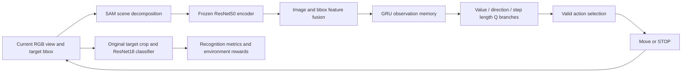
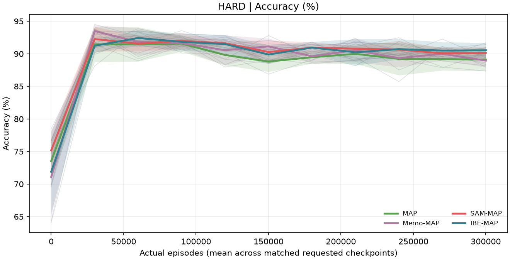
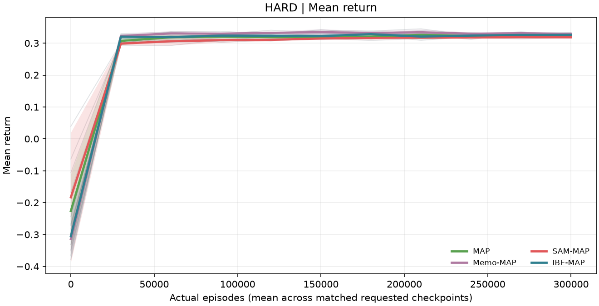

# UAV Active Visual Recognition with Scene Decomposition and Memory

**English | [简体中文](README.zh-CN.md)**

Where should a UAV move, how far should it travel, and when should it stop observing an occluded target? This project builds a discrete active viewing environment from UEVAVD multiview images and combines **SAM scene decomposition, GRU memory, and deep reinforcement learning** to balance vehicle recognition against movement cost.

This independent research implementation follows the [UEVAVD paper, arXiv v1](https://arxiv.org/abs/2411.04348v1). It includes four learned policies, three reference policies, and a complete workflow for training, evaluation, and trajectory verification across five random seeds. **This is not the authors' official code and does not claim to reproduce the paper's results exactly.**

## Features

- **Active viewing environment:** 605 discrete viewpoints per scene, six movement directions, 10–40 m step lengths, and a STOP action.
- **Scene decomposition:** actual SAM inference with bounding box and point prompts preserves target RGB while replacing surrounding segmented regions with reproducible random grayscale values.
- **Observation memory:** a GRU encodes the causal observation sequence within each episode; online and target hidden states are reconstructed from complete episode prefixes during training.
- **Policy learning:** Double DQN with value, direction advantage, and step length advantage branches, valid action masking, and explicit movement and decision costs.
- **Ablation studies:** controlled comparisons with and without SAM or GRU under the same classifier, starting viewpoints, rewards, and action budget.
- **Auditable experiments:** five random seeds, fixed final checkpoints, training/test curves, paired statistics, full trajectory exports, and independent verification.
- **Visualization:** offline HTML reports, viewing trajectories, success/failure examples, SAM previews, and generalization gap plots.

Viewpoint changes are simulated using an offline multiview dataset. Unreal Engine and AirSim are not required to run the project.

## Method



SAM images are used only by the **policy encoder**. Recognition results and rewards for every policy come from the same frozen classifier applied to **target crops from the original images**. Policies do not access ground truth classes, scene IDs, or classifier scores from unvisited viewpoints. Ground truth classes are used for training rewards and evaluation; ground truth bounding boxes provide the known target location.

| Policy | Policy input | GRU | Action selection |
|---|---|---|---|
| Stationary | — | — | Stop immediately |
| Sweep | Current original-view classifier output | — | Ascend, then scan laterally; stop by confidence |
| Random | Current original-view classifier output | — | Random valid moves, preferring unvisited positions; stop by confidence |
| MAP | Original RGB and bbox | No | Learn direction, step length, and stopping |
| Memo-MAP | Original RGB and bbox | Yes | Learn direction, step length, and stopping |
| SAM-MAP | SAM-decomposed RGB and bbox | No | Learn direction, step length, and stopping |
| IBE-MAP | SAM-decomposed RGB and bbox | Yes | Learn direction, step length, and stopping |

The 2048-dimensional image features are projected to 512 dimensions and concatenated with a 32-dimensional bbox embedding. Memory policies process the resulting 544-dimensional features with a single-layer GRU of hidden size 544, followed by a projection to a 512-dimensional state. See the [environment protocol](map_baseline/PROTOCOL.md) and [SAM/GRU protocol](ibe_map/PROTOCOL.md) for implementation details; these supporting documents are currently in Chinese.

## Results across five random seeds

These are results from the completed local experiments, reported as **mean ± sample standard deviation** across five seeds. Each policy is evaluated on the same 25 hard scenes × 605 starting viewpoints, giving 15,125 episodes per seed.

| Policy | Accuracy (%) ↑ | Mean discounted return ↑ | Mean travel distance (m) ↓ |
|---|---:|---:|---:|
| Stationary | 76.89 ± 0.00 | 0.2689 ± 0.0000 | 0.00 ± 0.00 |
| Sweep | **92.33 ± 0.00** | 0.2584 ± 0.0000 | 30.21 ± 0.00 |
| Random | 87.93 ± 0.14 | 0.2278 ± 0.0008 | 24.80 ± 0.14 |
| MAP | 89.11 ± 1.41 | 0.3247 ± 0.0049 | 11.03 ± 1.66 |
| Memo-MAP | 88.96 ± 0.81 | **0.3290 ± 0.0034** | 9.97 ± 1.06 |
| SAM-MAP | 90.14 ± 0.81 | 0.3182 ± 0.0018 | 14.96 ± 0.95 |
| IBE-MAP | **90.54 ± 0.93** | 0.3259 ± 0.0042 | 14.01 ± 1.42 |

Stationary and Sweep are deterministic references, rather than five independent training runs. Random varies across evaluation seeds; the four learned policies vary across training seeds. Travel distance measures movement cost and should be interpreted together with accuracy and return.

IBE-MAP has the highest mean accuracy among the four learned policies, while Sweep has the highest accuracy overall. The paired IBE-MAP−MAP accuracy difference is **+1.43 percentage points**, with a **95% t interval of [+0.29, +2.56]**. The paired return difference is +0.00124, with an interval of [−0.00372, +0.00619], which includes zero. Memo-MAP has the highest mean return. These results do not establish that SAM+GRU consistently outperforms the baselines on every metric.

Seeds are `42, 43, 44, 45, 46`. The 20 formal training runs each request 300,000 episodes and completed 6,000,364 episodes in total. Original independent verification records cover 440 curve points, 135 final metric groups, and 3,630,000 final evaluation trajectories. There are only five seeds, and paired comparisons are not corrected for multiple testing. Intervals describe training randomness under the fixed scenes and upstream models.





The repository includes a [machine-readable statistical summary](docs/results/metrics.json), [raw curve data](docs/results/curves.json), and [result file notes](docs/results/README.md). The full statistical procedure is documented in [MULTISEED.md](ibe_map/MULTISEED.md). The notes and detailed protocol are currently in Chinese. Large trajectory files, models, and observation caches are excluded from Git and can be regenerated using the workflow below.

## Installation

Python 3.12 and an NVIDIA CUDA environment compatible with your PyTorch installation are recommended. Use a GPU for full SAM preprocessing and the five-seed experiments. Dependency files specify minimum versions rather than a cross-platform lockfile; the original experiments used Python 3.12 and PyTorch `2.14.0+cu130`. Fixed seeds do not guarantee identical results across hardware.

```bash
git clone https://github.com/DeepBluesL/UAV-Active-Visual-Recognition-with-Scene-Decomposition-and-Memory.git
cd UAV-Active-Visual-Recognition-with-Scene-Decomposition-and-Memory
python -m venv .venv
```

Activate the environment with `.\.venv\Scripts\Activate.ps1` in Windows PowerShell or `source .venv/bin/activate` on Linux/macOS. Then install the dependencies:

```bash
python -m pip install --upgrade pip
python -m pip install -r requirements-ibe.txt
```

If you need a specific CUDA build, install a compatible PyTorch build first, then the remaining dependencies. The project implements ResNet18/ResNet50 locally and includes a subset of SAM model source files. The torchvision, transformers, and segment-anything pip packages are not required.

## Dataset preparation

Download the multiview images and `train_605` using the links in the [official UEVAVD dataset repository](https://github.com/Leo000ooo/UEVAVD_dataset). Extract and arrange them as follows:

```text
dataset/
├── multiview_imgs/
│   ├── 00/
│   ├── 01/
│   │   ├── bboxes.json
│   │   └── x_..._y_..._z_..._tar_...png
│   ├── ...
│   └── 150/
└── train_605/
    ├── SM_Hatchback_17/
    ├── SM_Pickup_5/
    ├── SM_Sedan_01a_14/
    ├── SM_SportsCar_2/
    └── SM_SUV_01a_17/
```

UEVAVD contains synthetic images of five vehicle classes: Hatchback, Pickup, Sedan, Sportscar, and SUV. This implementation uses scenes 1–150 and reads the 605 annotated viewpoints in each scene's `bboxes.json`. Scene 00 and extra unannotated images are excluded from policy experiments. The classifier dataset, `train_605`, contains 3,025 cropped images.

Each block of 30 scenes for a vehicle class is split into 20/5/5 scenes, giving **100 train / 25 simple / 25 hard** scenes. Exact scene lists are defined in `map_baseline.environment`. Coordinates follow AirSim NED: `z < 0`, altitude is `-z`, and ascending decreases z. An empty bbox indicates an invisible target, whose classifier output is Unknown.

Raw images, the dataset paper PDF, and model weights are not distributed with this repository. Dataset and upstream weight usage remains subject to the terms of their respective sources.

## Reproduce the experiments

Run these commands from the repository root in the activated Python environment. The first run needs internet access to download official ImageNet and SAM pretrained weights. Prepare the dataset before starting.

### 1. Train the classifier and prepare original-view caches

```bash
python demo/classifier.py --epochs 8
python -m map_baseline.features
```

The classifier uses an 80%/20% training/validation split within each class of `train_605`. This internal validation set contains neighboring unoccluded views and does not measure generalization to independent scenes. The trained classifier is then frozen and shared by all policies.

### 2. Prepare SAM, scene decomposition, and policy features

```bash
python ibe_map/bootstrap_sam.py
python -m ibe_map.features --batch-size 1
```

SAM uses the official pretrained ViT-B checkpoint. The bootstrap script verifies the pinned model source against `third_party/segment_anything/SOURCE.json`, downloads weights, and records their hash. A batch size of 1 reduces GPU memory usage; increase it if your device allows. Preprocessing covers 150 × 605 = 90,750 observations, reuses valid caches, and can resume scene decomposition from completed batches.

### 3. Run the existing regression checks

```bash
python -m unittest map_baseline.test_environment ibe_map.test_recurrence ibe_map.test_sam ibe_map.test_sam_attention ibe_map.test_snapshots ibe_map.test_multiseed
```

Checks cover environment boundaries and rewards, causal GRU prefixes and episode resets, SAM randomization, attention equivalence, checkpoints, and statistics across seeds. This command does not run full training or trajectory evaluation.

### 4. Train and evaluate across five seeds

```bash
python -m ibe_map.multiseed --stage all
python -m ibe_map.verify_multiseed
python -c "from ibe_map.multiseed_report import render_report; print(render_report('output/ibe_multiseed/summary.json', 'output/ibe_multiseed'))"
```

The `all` stage fixes the experiment identity, trains every model, evaluates learning curves, performs final evaluation and trajectory verification for each seed, and aggregates the statistics. Defaults are four learned policies × five seeds, 300,000 episodes per run, and checkpoints every 30,000 episodes. All training finishes before hard-test curves are evaluated. Final metrics use the checkpoint at the final episode budget; the best point on a test curve is never selected.

On Windows, after preparing the data and caches above, you can also use the PowerShell runner:

```powershell
.\run_multiseed.ps1 -Python (Get-Command python).Source

# For separate stages, run train / curves / final / summarize in order
.\run_multiseed.ps1 -Stage train -Python (Get-Command python).Source

# Rebuild plots from an existing summary.json
.\run_multiseed.ps1 -Stage report -Python (Get-Command python).Source
```

The scripts' default Python path comes from the original experiment machine. Pass `-Python` explicitly on other machines. Use a new `--out` / `-Out` directory when changing seeds, budgets, source code, or caches to avoid mixing experiment identities. Interrupted training jobs restart from initialization; exact continuation from optimizer state is not implemented.

### 5. Run the lightweight heuristic demo

After training the classifier, you can first run a smaller demonstration:

```bash
python demo/run_demo.py
```

The default report is `output/demo/report.html`. This demo compares Stationary, Random, and Sweep without SAM, GRU, or learned policies. Its starting viewpoints and decision conventions differ from the main experiment. Historical notes are preserved in [README-DEMO.md](README-DEMO.md), in Chinese; those results are not directly comparable with the five-seed table above.

## Experimental protocol and outputs

The action set contains 24 movement actions and one STOP action. Invalid boundary-crossing actions are masked before selection. An episode allows at most five decisions; the fifth decision may still move before termination, so up to six observation positions can be visited. The discount factor is 0.9. Terminal success earns +0.5 and failure earns −0.5; nonterminal steps incur −0.1, with an additional −0.02 per 10 m traveled. Success requires a visible target, a correct top-1 prediction, and a true-class score strictly above 0.2.

Training uses Adam at `1e-4`, batch size 256, 64 parallel environments, a replay capacity of 100,000 transitions, a 2,048-transition warmup, and target synchronization every 500 updates. GRU samples retain complete episode prefixes; terminal transitions do not bootstrap and padding contributes no loss. The additional fixed-three-move diagnostic controls movement count, rather than equal distance traveled.

| Generated local path | Contents |
|---|---|
| `output/demo/classifier.pt` | Shared vehicle classifier |
| `output/map/cache/` | Original-view features, classifier outputs, and data identity |
| `output/ibe_map/cache/` | SAM image features and associated identity |
| `output/ibe_map/decomposed/` | Decomposed images and preprocessing progress |
| `output/ibe_map/sam_preview/` | Actual masks, prompt points, and previews |
| `output/ibe_multiseed/run_manifest.json` | Seeds, budgets, protocol, source hashes, and cache hashes |
| `output/ibe_multiseed/seed_<seed>/<policy>/train/` | Initial, intermediate, and final models; training logs |
| `output/ibe_multiseed/seed_<seed>/evaluation/` | Per-seed metrics, CSV, compressed trajectories, and verification |
| `output/ibe_multiseed/summary.json` | Full statistics across seeds and paired comparisons |
| `output/ibe_multiseed/summary_verification.json` | Independent verification across seeds |
| `output/ibe_multiseed/report.html` | Offline report |

Caches and checkpoints validate the classifier, encoder, SAM, data location, preprocessing, and file hashes. Rebuild caches and experiment outputs after relocating data or changing preprocessing. Example trajectories are selected after evaluation for interpretation; the main table uses all shared starting viewpoints.

## Repository structure

```text
demo/                         Classifier and historical heuristic demo
map_baseline/                 Discrete environment, MAP, feature caches, and tests
ibe_map/                      SAM, GRU, ablations, multiseed experiments, and verification
third_party/segment_anything/ Pinned SAM model source, provenance, and license
docs/results/                 Published statistics and curves
requirements-*.txt            Dependencies for each experiment stage
run_*.ps1                     Windows experiment runners
README.md                     English documentation (default)
README.zh-CN.md               Simplified Chinese documentation
README-DEMO.md                Historical demo notes
```

## Reproduction scope and limitations

- **SAM is not fine-tuned:** the available dataset copy lacks pixel-level target segmentation annotations, and the authors' fine-tuned weights were not available. The project uses official pretrained ViT-B and does not report segmentation accuracy against ground truth masks.
- **Visual backbones are frozen:** policies use a frozen ResNet50 and a shared, previously trained ResNet18 classifier, rather than end-to-end visual encoder training.
- **Target boxes are given:** dataset ground truth bounding boxes replace online detection and tracking.
- **Motion is offline and discrete:** the environment does not simulate flight dynamics, collisions, energy consumption, or localization errors. Path length is the Euclidean distance of grid movements.
- **Some details are implementation choices:** Q-branch composition, SAM surrounding-point sampling, and cached randomization are explicitly documented local choices and are not claimed to match the authors' unpublished implementation exactly.
- **Statistical scope is limited:** five-seed intervals do not estimate uncertainty from new scenes, classifier retraining, or SAM fine-tuning, and do not replace real flight validation.

The [MAP protocol](map_baseline/PROTOCOL.md), [SAM/GRU protocol](ibe_map/PROTOCOL.md), and [five-seed notes](ibe_map/MULTISEED.md) preserve the experimental rationale in Chinese. Single-seed descriptions in the first two protocols refer to historical stages. The current main results are those in this README and the five-seed notes.

## References and attribution

This project builds on UEVAVD by Jiang et al.: [arXiv v1 paper](https://arxiv.org/abs/2411.04348v1) and [official dataset repository](https://github.com/Leo000ooo/UEVAVD_dataset). Please cite the original paper when using UEVAVD.

```bibtex
@article{jiang2024uevavd,
  title={UEVAVD: A Dataset for Developing UAV's Eye View Active Object Detection},
  author={Jiang, Xinhua and Liu, Tianpeng and Liu, Li and Liu, Zhen and Liu, Yongxiang},
  journal={arXiv preprint arXiv:2411.04348},
  year={2024},
  doi={10.48550/arXiv.2411.04348}
}
```

SAM comes from [Meta Segment Anything](https://github.com/facebookresearch/segment-anything), pinned to commit `dca509fe793f601edb92606367a655c15ac00fdf`. Upstream model source and the Apache-2.0 license are preserved in [third_party/segment_anything](third_party/segment_anything). ImageNet initialization weights come from official PyTorch download endpoints. Data, third-party code, and weights retain their respective rights; no additional open-source license has yet been assigned to this project's own code.
