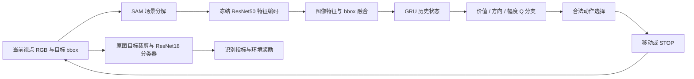

# UAV Active Visual Recognition with Scene Decomposition and Memory

**[English](README.md) | 简体中文**

**基于场景分解与历史记忆的无人机主动视觉识别**

在遮挡场景中，无人机应该朝哪里移动、移动多远，以及何时停止观察？本项目使用 UEVAVD 的多视角图像构建离散主动观察环境，通过 **SAM 场景分解、GRU 历史记忆和深度强化学习**，学习兼顾车辆识别效果与移动成本的观察策略。

这是依据 [UEVAVD 论文 arXiv v1](https://arxiv.org/abs/2411.04348v1) 自行实现的研究项目，包含四种学习策略、三种参考策略，以及五随机种子训练、评估和轨迹核验流程。**本仓库不是论文作者的官方代码，不声称完整复现论文数值。**

## 项目能力

- **主动观察环境**：每场景 605 个离散视点，支持六方向移动、10–40 m 步长和 STOP。
- **场景分解**：通过实际 SAM bbox/点提示推理保留目标 RGB，将周围分割区域替换为可复现的随机灰度。
- **历史记忆**：GRU 编码当前回合的因果观察序列，训练时从完整前缀重建 online/target 隐状态。
- **策略学习**：Double DQN、价值/方向/幅度优势分支、合法动作屏蔽，以及距离和决策成本。
- **模块消融**：在相同分类器、起点、奖励和动作预算下比较是否使用 SAM、是否使用 GRU。
- **可审计实验**：五随机种子、固定最终模型、训练/测试曲线、配对统计、完整轨迹导出与独立核验。
- **结果展示**：生成离线 HTML 报告、观察轨迹、成功/失败案例、SAM 预览及泛化差距图。

本项目在离线多视角数据上模拟观察位置变化；运行不需要 Unreal Engine 或 AirSim。

## 方法



SAM 分解图只进入**策略编码器**；所有策略的识别结果与奖励均来自同一个冻结分类器对**原图目标裁剪**的预测。策略不读取真实类别、场景编号或尚未到达视点的分类分数。GT 类别用于训练奖励和事后统计，GT bbox 用作已知目标位置输入。

| 策略 | 策略输入 | GRU | 行动方式 |
|---|---|---|---|
| Stationary | — | — | 原地停止 |
| Sweep | 当前原图分类输出 | — | 先升高再横向扫描，按置信度停止 |
| Random | 当前原图分类输出 | — | 随机合法移动、优先未访问位置，按置信度停止 |
| MAP | 原始 RGB 与 bbox | 否 | 学习方向、步长与停止 |
| Memo-MAP | 原始 RGB 与 bbox | 是 | 学习方向、步长与停止 |
| SAM-MAP | SAM 分解 RGB 与 bbox | 否 | 学习方向、步长与停止 |
| IBE-MAP | SAM 分解 RGB 与 bbox | 是 | 学习方向、步长与停止 |

图像编码为 2048 维，经投影得到 512 维；bbox 编码为 32 维；拼接后为 544 维。记忆策略使用隐藏维度 544 的单层 GRU，再投影为 512 维状态。完整实现约定见 [环境协议](map_baseline/PROTOCOL.md) 和 [SAM / GRU 协议](ibe_map/PROTOCOL.md)。

## 五随机种子结果

下表来自本地已完成实验，数值为五种子的**均值 ± 样本标准差**。每个种子、每种策略在同一组 25 个 hard 场景 × 605 个起点上评估，即 15,125 回合。

| 策略 | 准确率（%）↑ | 平均折扣回报 ↑ | 平均移动距离（m）↓ |
|---|---:|---:|---:|
| Stationary | 76.89 ± 0.00 | 0.2689 ± 0.0000 | 0.00 ± 0.00 |
| Sweep | **92.33 ± 0.00** | 0.2584 ± 0.0000 | 30.21 ± 0.00 |
| Random | 87.93 ± 0.14 | 0.2278 ± 0.0008 | 24.80 ± 0.14 |
| MAP | 89.11 ± 1.41 | 0.3247 ± 0.0049 | 11.03 ± 1.66 |
| Memo-MAP | 88.96 ± 0.81 | **0.3290 ± 0.0034** | 9.97 ± 1.06 |
| SAM-MAP | 90.14 ± 0.81 | 0.3182 ± 0.0018 | 14.96 ± 0.95 |
| IBE-MAP | **90.54 ± 0.93** | 0.3259 ± 0.0042 | 14.01 ± 1.42 |

Stationary 与 Sweep 是确定性参考，不是五次独立训练；Random 的离散来自评估随机种子，其余四种策略的离散来自训练随机种子。距离描述移动成本，须结合准确率和回报判断。

IBE-MAP 的平均准确率在四种学习策略中最高，整体最高准确率来自 Sweep。IBE-MAP−MAP 的配对准确率差为 **+1.43 个百分点**，95% t 区间为 **[+0.29, +2.56]**；配对回报差为 +0.00124，区间 [−0.00372, +0.00619] 跨零。Memo-MAP 的平均回报最高。这些结果不支持宣称 SAM+GRU 在所有指标上普遍优于基线。

实验使用种子 `42, 43, 44, 45, 46`，共 20 次正式训练，每次请求 300,000 回合，实际合计完成 6,000,364 回合。原实验的独立核验记录覆盖 440 个曲线点、135 组最终指标和 3,630,000 条最终评估轨迹。只有五个种子，配对比较未做多重检验校正；区间只描述固定场景和上游模型条件下的训练随机性。


仓库附带 [机器可读统计摘要](docs/results/metrics.json)、[原始曲线数据](docs/results/curves.json) 和 [结果文件说明](docs/results/README.md)。完整统计方法见 [MULTISEED.md](ibe_map/MULTISEED.md)。大体积逐步轨迹、模型和观察缓存不随 Git 仓库发布，可按下述流程重新生成。

## ResNet50 端到端训练对照

按用户最新要求，当前只完成 **seed 42 的 MAP 端到端训练**，预算 30 万回合，与相同种子的 BF16 冻结 MAP 比较。包括 SAM+GRU 在内的另外九次端到端训练均已取消，已完成的冻结训练保留。详见[当前流程](e2e_map/CURRENT.md)和[核验后的 MAP 参考结果](docs/e2e_map_reference/README.md)。这是单种子 MAP 参考，不能判断稳定改善或 SAM+GRU 的变化；[原五种子方案](e2e_map/README.md)另行保留。

当前训练已完成 300,005 回合，AMP 跳过 0 次。与匹配冻结对照相比，simple 准确率为 95.00% 对 91.06%，hard 为 91.99% 对 90.02%；hard 折扣回报从 0.3253 升至 0.3562，距离从 11.96 m 略增至 12.16 m。全部 211,750 条评估轨迹通过独立核验。[训练计算优化及 GPU 短测](e2e_map/PERFORMANCE.md)单独记录，不混入上述识别结果。

## 安装

建议使用 Python 3.12 和支持当前 PyTorch 版本的 NVIDIA CUDA 环境。完整 SAM 预处理和五种子实验建议在 GPU 上运行。依赖文件声明最低版本，不是跨平台锁定环境；原实验使用 Python 3.12、PyTorch `2.14.0+cu130`。固定种子不保证跨硬件逐位相同。

```bash
git clone https://github.com/DeepBluesL/UAV-Active-Visual-Recognition-with-Scene-Decomposition-and-Memory.git
cd UAV-Active-Visual-Recognition-with-Scene-Decomposition-and-Memory
python -m venv .venv
```

激活环境：Windows PowerShell 使用 `.\.venv\Scripts\Activate.ps1`；Linux/macOS 使用 `source .venv/bin/activate`。随后安装依赖：

```bash
python -m pip install --upgrade pip
python -m pip install -r requirements-ibe.txt
```

如需特定 CUDA 构建，先根据硬件安装匹配的 PyTorch，再安装其余依赖。本项目自行实现 ResNet18/ResNet50，并使用仓库内的 SAM 模型源码子集，无需安装 torchvision、transformers 或 segment-anything pip 包。

## 数据准备

从 [UEVAVD 作者仓库](https://github.com/Leo000ooo/UEVAVD_dataset) 提供的入口下载多视角图像和 `train_605`，解压并整理为：

```text
dataset/
├── multiview_imgs/
│   ├── 00/
│   ├── 01/
│   │   ├── bboxes.json
│   │   └── x_..._y_..._z_..._tar_...png
│   ├── ...
│   └── 150/
└── train_605/
    ├── SM_Hatchback_17/
    ├── SM_Pickup_5/
    ├── SM_Sedan_01a_14/
    ├── SM_SportsCar_2/
    └── SM_SUV_01a_17/
```

数据集图像由仿真生成，覆盖 Hatchback、Pickup、Sedan、Sportscar、SUV 五类车辆。本实现使用场景 1–150，每场景读取 `bboxes.json` 中的 605 个视点；场景 00 和未配标注的额外图像不进入策略实验。`train_605` 共 3,025 张分类裁剪图。

每类连续 30 个场景按 20/5/5 划分，合计 **100 train / 25 simple / 25 hard**。准确场景清单由 `map_baseline.environment` 定义。坐标遵循 AirSim NED：`z < 0`，高度为 `-z`，上升使 z 减小。空 bbox 表示目标不可见，分类输出为 Unknown。

原始图像、数据集论文 PDF 和模型权重不随仓库上传；数据与上游权重的使用遵循各自来源条款。

## 从零复现实验

以下命令均在仓库根目录、已激活的 Python 环境中执行。首次运行需要联网下载官方 ImageNet 和 SAM 预训练权重；数据必须先按上述结构准备好。

### 1. 训练分类器并准备原图观察缓存

```bash
python demo/classifier.py --epochs 8
python -m map_baseline.features
```

分类器在 `train_605` 内按类别做 80%/20% 训练/验证划分。内部验证来自相邻无遮挡视角，不能作为独立场景泛化性能。之后固定分类器供全部策略共享。

### 2. 准备 SAM、场景分解与策略特征

```bash
python ibe_map/bootstrap_sam.py
python -m ibe_map.features --batch-size 1
```

SAM 使用官方预训练 ViT-B，bootstrap 脚本根据 `third_party/segment_anything/SOURCE.json` 校验固定版本模型源码，下载权重并记录哈希。`--batch-size 1` 用于降低显存占用，可按设备增大。预处理覆盖 150 × 605 = 90,750 个观察，支持复用有效缓存和按已完成批次恢复分解进度。

### 3. 运行已有回归检查

```bash
python -m unittest map_baseline.test_environment ibe_map.test_recurrence ibe_map.test_sam ibe_map.test_sam_attention ibe_map.test_snapshots ibe_map.test_multiseed
```

检查环境边界和奖励、GRU 因果前缀与回合重置、SAM 随机化、注意力等价性、检查点及跨种子统计。此命令不执行完整训练与轨迹评估。

### 4. 五随机种子训练与评估

```bash
python -m ibe_map.multiseed --stage all
python -m ibe_map.verify_multiseed
python -c "from ibe_map.multiseed_report import render_report; print(render_report('output/ibe_multiseed/summary.json', 'output/ibe_multiseed'))"
```

`all` 依次固定实验身份、训练全部模型、评估训练曲线、执行最终评估与逐种子轨迹核验，再汇总统计。默认四种学习策略 × 五个种子，每次 300,000 回合，每 30,000 回合保存检查点。所有训练完成后才评估 hard 曲线；最终指标固定使用最后预算的模型，不按测试曲线选最佳模型。

Windows 也可用一键脚本，在上述数据和缓存准备完成后执行：

```powershell
.\run_multiseed.ps1 -Python (Get-Command python).Source

# 分阶段执行时，依次使用 train / curves / final / summarize
.\run_multiseed.ps1 -Stage train -Python (Get-Command python).Source

# 从已有 summary.json 重建图表
.\run_multiseed.ps1 -Stage report -Python (Get-Command python).Source
```

现有 PowerShell 脚本的默认 Python 路径来自原实验机器；在其他机器请显式传入 `-Python`。修改种子、预算、源码或缓存时，通过 `--out` / `-Out` 指定新目录，避免混用实验身份。中断训练的任务会重新初始化重训，不提供优化器状态的精确续训。

### 5. 轻量规则演示

完成分类器训练后，可以先运行较小规模演示：

```bash
python demo/run_demo.py
```

默认生成 `output/demo/report.html`。该演示比较原地、随机与规则扫描，不使用 SAM、GRU 或学习策略，且起点与决策口径不同。历史说明保留于 [README-DEMO.md](README-DEMO.md)，其结果不与当前五种子主表直接混比。

## 实验协议与输出

动作集合为 24 个移动动作加一个 STOP，越界动作在选择前屏蔽。每回合最多 5 次决策，第五次仍可移动后结束，因此最多访问 6 个观察位置。折扣因子为 0.9；终止成功奖励 +0.5、失败 −0.5；非终止惩罚 −0.1；每移动 10 m 再扣 0.02。成功要求目标可见、top-1 正确且真实类别分数严格大于 0.2。

训练使用 Adam `1e-4`、batch 256、64 个并行环境、100,000 transition replay、2,048 transition warmup 和每 500 次更新同步 target。GRU 样本携带完整回合前缀；终止不 bootstrap，padding 不产生 loss。固定三次移动的诊断控制移动次数，不等于相同米数预算。

| 本地生成路径 | 内容 |
|---|---|
| `output/demo/classifier.pt` | 共享车辆分类器 |
| `output/map/cache/` | 原图特征、分类输出及数据身份 |
| `output/ibe_map/cache/` | SAM 分解图特征与对应身份 |
| `output/ibe_map/decomposed/` | 分解图与预处理进度 |
| `output/ibe_map/sam_preview/` | 实际 mask、提示点与预览 |
| `output/ibe_multiseed/run_manifest.json` | 种子、预算、协议、源码与缓存哈希 |
| `output/ibe_multiseed/seed_<seed>/<policy>/train/` | 初始化、中间/最终模型及训练日志 |
| `output/ibe_multiseed/seed_<seed>/evaluation/` | 每种子指标、CSV、压缩轨迹及核验 |
| `output/ibe_multiseed/summary.json` | 完整跨种子统计和配对比较 |
| `output/ibe_multiseed/summary_verification.json` | 跨种子独立核验记录 |
| `output/ibe_multiseed/report.html` | 本地离线报告 |

缓存与 checkpoint 校验分类器、编码器、SAM、数据位置、预处理及文件哈希；数据迁移或预处理变更后应重新准备缓存和实验。示例轨迹为评估后的解释样例，主表统计使用全部共同起点。

## 仓库结构

```text
demo/                         分类器与历史规则演示
map_baseline/                 离散环境、MAP、特征缓存及测试
ibe_map/                      SAM、GRU、消融、多种子实验与核验
e2e_map/                      ResNet50 端到端训练、BF16 匹配冻结对照与核验汇总
third_party/segment_anything/ 固定版本 SAM 模型源码、来源与许可证
docs/results/                 发布的统计摘要与曲线
docs/e2e_map_reference/       核验后的单种子 MAP 参考与短性能测试
requirements-*.txt            分阶段 Python 依赖
run_*.ps1                     Windows 调度脚本
README.md                     英文版项目说明（默认）
README.zh-CN.md               简体中文版项目说明
README-DEMO.md                原始演示阶段运行记录
```

## 复现范围与限制

- **SAM 未微调**：当前数据副本未包含像素级目标分割标注，未获得作者微调权重；使用官方预训练 ViT-B，不报告对真实分割标注的准确率。
- **主干训练单独对比**：上文历史结果使用冻结 ResNet50；新增端到端实验训练 ResNet50 参数并固定预训练 BatchNorm 运行统计量。两组共享相同的冻结 ResNet18 识别结果。
- **已知目标框**：使用数据集 GT bbox，不包含在线检测器或跟踪器。
- **离线离散运动**：不模拟真实飞行动力学、碰撞、能耗或定位误差，路径指标为网格欧氏移动距离。
- **实现选择**：Q 分支合成、SAM 周围点采样和缓存随机化等细节为文档化的本地选择，不代表与作者未公开实现精确对齐。
- **统计适用范围**：五种子区间不估计新场景、分类器重训或 SAM 微调的不确定性，不能替代真实飞行验证。

[MAP 协议](map_baseline/PROTOCOL.md)、[SAM / GRU 协议](ibe_map/PROTOCOL.md) 与 [五种子说明](ibe_map/MULTISEED.md) 保留分阶段实验依据。前两份协议中的单种子描述属于历史阶段，当前主结果以本 README 和五种子说明为准。

## 参考与署名

本项目参考 Jiang 等人的 UEVAVD 工作：[论文 arXiv v1](https://arxiv.org/abs/2411.04348v1)、[作者数据仓库](https://github.com/Leo000ooo/UEVAVD_dataset)。使用数据时请引用原论文。

```bibtex
@article{jiang2024uevavd,
  title={UEVAVD: A Dataset for Developing UAV's Eye View Active Object Detection},
  author={Jiang, Xinhua and Liu, Tianpeng and Liu, Li and Liu, Zhen and Liu, Yongxiang},
  journal={arXiv preprint arXiv:2411.04348},
  year={2024},
  doi={10.48550/arXiv.2411.04348}
}
```

SAM 来自 [Meta Segment Anything](https://github.com/facebookresearch/segment-anything)，固定 commit 为 `dca509fe793f601edb92606367a655c15ac00fdf`，上游模型源码及 Apache-2.0 许可证保留在 [third_party/segment_anything](third_party/segment_anything)。ImageNet 初始化权重由 PyTorch 官方下载源提供。数据、第三方代码和权重保留各自权利；本仓库暂未为自有代码指定额外开源许可证。
