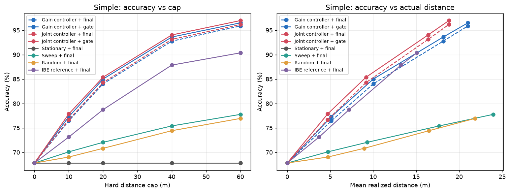
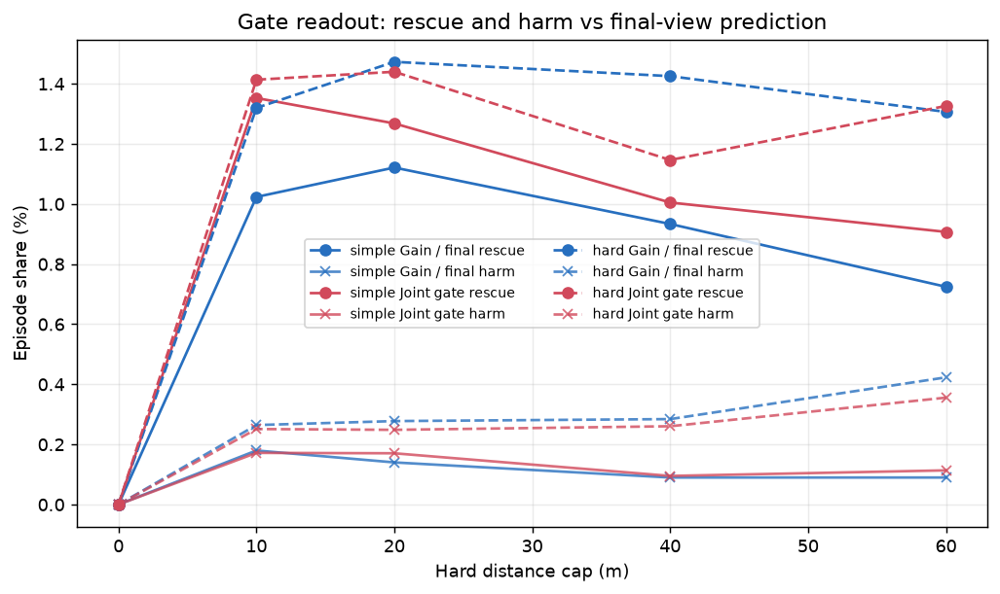
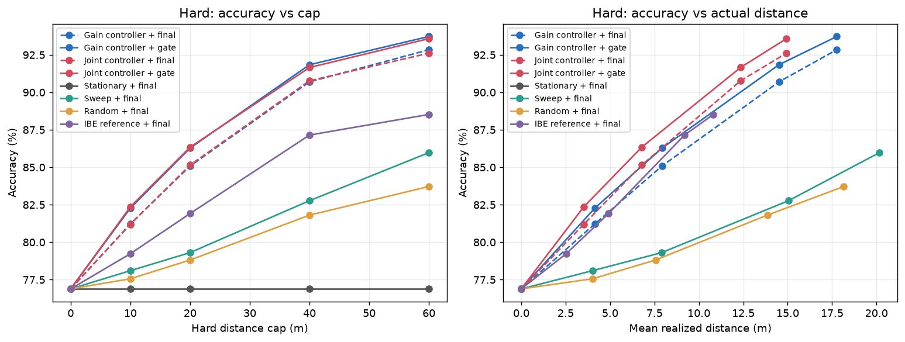

# 主动证据预测评估报告

评估仅衡量当前观测下的一步收益预测与证据门控。预算上限不代表各策略实际行驶距离相同；图中同时报告上限与实耗。结果不构成 SOTA 或普遍稳定优势的主张。

## 结果图

| 测试划分 | 准确率与预算/实耗 | 门控救回与误伤 |
|---|---|---|
| simple |  |  |
| hard |  |  |

## 验证与模型选择

独立核验通过：`True`。五个新模块训练种子为 42–46，并共享冻结的上游分类器、ResNet50 特征与 SAM 分解。simple/hard 划分已有过往实验探索，因此本次是复评，不视为未触碰的确认集。成本系数在 validation 选择，最终测试只报告冻结选择。准确率、距离和未知率区间是五个种子上的普通 t 区间（df=4），不是配对区间；n=1 的确定性结果没有区间。stationary 与 sweep 的 final/max_confidence/mean 读出确定性去重；它们的 gate 读出仍随 gate 种子变化。IBE reference 是五个不同种子的历史策略检查点，保留五种子；random 同样保留五种子。

内部 validation 初始状态 gain Brier（五种子范围、均值）：gain_final 0.0984–0.1003，均值 0.0992。
gain_gate 0.0568–0.0609，均值 0.0584；这是一步收益标签概率校准，不等于最终分类准确率。

## 主要比较

| 划分 | 控制器/读出 | 预算(m) | 准确率 均值±SD，95%普通t区间 | 实际距离(m) 均值±SD | 未知率 |
|---|---|---:|---|---|---|
| simple | gain_final/final | 0 | 67.81% ± 0.00 [67.81, 67.81] | 0.00 ± 0.00 | 7.00% |
| simple | gain_final/final | 10 | 76.44% ± 0.11 [76.30, 76.58] | 5.13 ± 0.09 | 3.69% |
| simple | gain_final/final | 20 | 84.02% ± 0.16 [83.82, 84.22] | 10.01 ± 0.17 | 1.32% |
| simple | gain_final/final | 40 | 92.76% ± 0.12 [92.60, 92.91] | 18.14 ± 0.21 | 0.21% |
| simple | gain_final/final | 60 | 95.87% ± 0.21 [95.60, 96.14] | 21.02 ± 0.29 | 0.07% |
| simple | gain_final/gate | 0 | 67.81% ± 0.00 [67.81, 67.81] | 0.00 ± 0.00 | 7.00% |
| simple | gain_final/gate | 10 | 77.29% ± 0.11 [77.15, 77.42] | 5.13 ± 0.09 | 3.66% |
| simple | gain_final/gate | 20 | 85.00% ± 0.18 [84.78, 85.22] | 10.01 ± 0.17 | 1.29% |
| simple | gain_final/gate | 40 | 93.60% ± 0.13 [93.44, 93.76] | 18.14 ± 0.21 | 0.05% |
| simple | gain_final/gate | 60 | 96.50% ± 0.23 [96.21, 96.79] | 21.02 ± 0.29 | 0.01% |
| simple | gain_gate/final | 0 | 67.81% ± 0.00 [67.81, 67.81] | 0.00 ± 0.00 | 7.00% |
| simple | gain_gate/final | 10 | 76.67% ± 0.15 [76.48, 76.85] | 4.70 ± 0.08 | 3.71% |
| simple | gain_gate/final | 20 | 84.28% ± 0.26 [83.96, 84.60] | 9.17 ± 0.11 | 1.38% |
| simple | gain_gate/final | 40 | 93.12% ± 0.11 [92.98, 93.26] | 16.38 ± 0.24 | 0.25% |
| simple | gain_gate/final | 60 | 96.17% ± 0.14 [96.00, 96.35] | 18.80 ± 0.27 | 0.15% |
| simple | gain_gate/gate | 0 | 67.81% ± 0.00 [67.81, 67.81] | 0.00 ± 0.00 | 7.00% |
| simple | gain_gate/gate | 10 | 77.85% ± 0.06 [77.78, 77.92] | 4.70 ± 0.08 | 3.67% |
| simple | gain_gate/gate | 20 | 85.38% ± 0.14 [85.21, 85.55] | 9.17 ± 0.11 | 1.33% |
| simple | gain_gate/gate | 40 | 94.03% ± 0.19 [93.79, 94.26] | 16.38 ± 0.24 | 0.05% |
| simple | gain_gate/gate | 60 | 96.97% ± 0.17 [96.76, 97.18] | 18.80 ± 0.27 | 0.03% |
| simple | stationary/final | 0 | 67.81% ± — — | 0.00 ± — | 7.00% |
| simple | stationary/final | 10 | 67.81% ± — — | 0.00 ± — | 7.00% |
| simple | stationary/final | 20 | 67.81% ± — — | 0.00 ± — | 7.00% |
| simple | stationary/final | 40 | 67.81% ± — — | 0.00 ± — | 7.00% |
| simple | stationary/final | 60 | 67.81% ± — — | 0.00 ± — | 7.00% |
| simple | sweep/final | 0 | 67.81% ± — — | 0.00 ± — | 7.00% |
| simple | sweep/final | 10 | 70.10% ± — — | 4.73 ± — | 5.58% |
| simple | sweep/final | 20 | 72.05% ± — — | 9.30 ± — | 4.42% |
| simple | sweep/final | 40 | 75.40% ± — — | 17.68 ± — | 3.47% |
| simple | sweep/final | 60 | 77.77% ± — — | 23.95 ± — | 3.11% |
| simple | random/final | 0 | 67.81% ± 0.00 [67.81, 67.81] | 0.00 ± 0.00 | 7.00% |
| simple | random/final | 10 | 69.04% ± 0.27 [68.71, 69.37] | 4.73 ± 0.00 | 6.72% |
| simple | random/final | 20 | 70.82% ± 0.29 [70.45, 71.18] | 8.94 ± 0.01 | 6.12% |
| simple | random/final | 40 | 74.42% ± 0.36 [73.98, 74.87] | 16.48 ± 0.02 | 4.93% |
| simple | random/final | 60 | 76.93% ± 0.33 [76.53, 77.34] | 21.84 ± 0.03 | 4.14% |
| simple | ibe_reference/final | 0 | 67.81% ± 0.00 [67.81, 67.81] | 0.00 ± 0.00 | 7.00% |
| simple | ibe_reference/final | 10 | 73.13% ± 0.33 [72.72, 73.53] | 3.70 ± 0.20 | 4.75% |
| simple | ibe_reference/final | 20 | 78.74% ± 0.61 [77.99, 79.49] | 7.20 ± 0.47 | 2.49% |
| simple | ibe_reference/final | 40 | 87.86% ± 0.81 [86.85, 88.86] | 13.23 ± 0.96 | 0.74% |
| simple | ibe_reference/final | 60 | 90.36% ± 1.01 [89.11, 91.62] | 15.06 ± 1.16 | 0.34% |
| hard | gain_final/final | 0 | 76.89% ± 0.00 [76.89, 76.89] | 0.00 ± 0.00 | 1.01% |
| hard | gain_final/final | 10 | 81.22% ± 0.19 [80.98, 81.46] | 4.14 ± 0.16 | 0.46% |
| hard | gain_final/final | 20 | 85.08% ± 0.21 [84.82, 85.35] | 7.92 ± 0.23 | 0.16% |
| hard | gain_final/final | 40 | 90.70% ± 0.31 [90.31, 91.09] | 14.51 ± 0.42 | 0.06% |
| hard | gain_final/final | 60 | 92.84% ± 0.31 [92.45, 93.23] | 17.77 ± 0.60 | 0.01% |
| hard | gain_final/gate | 0 | 76.89% ± 0.00 [76.89, 76.89] | 0.00 ± 0.00 | 1.01% |
| hard | gain_final/gate | 10 | 82.27% ± 0.05 [82.22, 82.33] | 4.14 ± 0.16 | 0.46% |
| hard | gain_final/gate | 20 | 86.28% ± 0.08 [86.19, 86.37] | 7.92 ± 0.23 | 0.16% |
| hard | gain_final/gate | 40 | 91.84% ± 0.16 [91.64, 92.04] | 14.51 ± 0.42 | 0.00% |
| hard | gain_final/gate | 60 | 93.72% ± 0.16 [93.52, 93.93] | 17.77 ± 0.60 | 0.00% |
| hard | gain_gate/final | 0 | 76.89% ± 0.00 [76.89, 76.89] | 0.00 ± 0.00 | 1.01% |
| hard | gain_gate/final | 10 | 81.20% ± 0.10 [81.07, 81.32] | 3.52 ± 0.17 | 0.48% |
| hard | gain_gate/final | 20 | 85.15% ± 0.17 [84.94, 85.36] | 6.78 ± 0.31 | 0.17% |
| hard | gain_gate/final | 40 | 90.77% ± 0.21 [90.51, 91.03] | 12.35 ± 0.60 | 0.05% |
| hard | gain_gate/final | 60 | 92.61% ± 0.26 [92.28, 92.94] | 14.93 ± 0.76 | 0.07% |
| hard | gain_gate/gate | 0 | 76.89% ± 0.00 [76.89, 76.89] | 0.00 ± 0.00 | 1.01% |
| hard | gain_gate/gate | 10 | 82.36% ± 0.07 [82.28, 82.44] | 3.52 ± 0.17 | 0.47% |
| hard | gain_gate/gate | 20 | 86.34% ± 0.08 [86.24, 86.44] | 6.78 ± 0.31 | 0.16% |
| hard | gain_gate/gate | 40 | 91.65% ± 0.31 [91.27, 92.04] | 12.35 ± 0.60 | 0.00% |
| hard | gain_gate/gate | 60 | 93.58% ± 0.35 [93.15, 94.01] | 14.93 ± 0.76 | 0.00% |
| hard | stationary/final | 0 | 76.89% ± — — | 0.00 ± — | 1.01% |
| hard | stationary/final | 10 | 76.89% ± — — | 0.00 ± — | 1.01% |
| hard | stationary/final | 20 | 76.89% ± — — | 0.00 ± — | 1.01% |
| hard | stationary/final | 40 | 76.89% ± — — | 0.00 ± — | 1.01% |
| hard | stationary/final | 60 | 76.89% ± — — | 0.00 ± — | 1.01% |
| hard | sweep/final | 0 | 76.89% ± — — | 0.00 ± — | 1.01% |
| hard | sweep/final | 10 | 78.10% ± — — | 4.02 ± — | 0.74% |
| hard | sweep/final | 20 | 79.31% ± — — | 7.90 ± — | 0.54% |
| hard | sweep/final | 40 | 82.77% ± — — | 15.05 ± — | 0.35% |
| hard | sweep/final | 60 | 85.98% ± — — | 20.17 ± — | 0.29% |
| hard | random/final | 0 | 76.89% ± 0.00 [76.89, 76.89] | 0.00 ± 0.00 | 1.01% |
| hard | random/final | 10 | 77.56% ± 0.09 [77.46, 77.67] | 4.02 ± 0.00 | 0.95% |
| hard | random/final | 20 | 78.81% ± 0.13 [78.65, 78.97] | 7.56 ± 0.02 | 0.88% |
| hard | random/final | 40 | 81.81% ± 0.25 [81.50, 82.11] | 13.85 ± 0.04 | 0.65% |
| hard | random/final | 60 | 83.72% ± 0.13 [83.56, 83.88] | 18.16 ± 0.08 | 0.52% |
| hard | ibe_reference/final | 0 | 76.89% ± 0.00 [76.89, 76.89] | 0.00 ± 0.00 | 1.01% |
| hard | ibe_reference/final | 10 | 79.23% ± 0.21 [78.97, 79.49] | 2.53 ± 0.13 | 0.68% |
| hard | ibe_reference/final | 20 | 81.91% ± 0.52 [81.27, 82.56] | 4.91 ± 0.35 | 0.36% |
| hard | ibe_reference/final | 40 | 87.15% ± 0.61 [86.39, 87.90] | 9.19 ± 0.70 | 0.13% |
| hard | ibe_reference/final | 60 | 88.52% ± 0.61 [87.76, 89.29] | 10.82 ± 0.88 | 0.06% |

## Hard split 重点预算

| 控制器/读出 | cap (m) | 准确率均值 (%) | 实际距离均值 (m) |
|---|---:|---:|---:|
| gain_final/final | 20 | 85.08 | 7.92 |
| gain_final/final | 40 | 90.70 | 14.51 |
| gain_final/final | 60 | 92.84 | 17.77 |
| gain_final/gate | 20 | 86.28 | 7.92 |
| gain_final/gate | 40 | 91.84 | 14.51 |
| gain_final/gate | 60 | 93.72 | 17.77 |
| gain_gate/final | 20 | 85.15 | 6.78 |
| gain_gate/final | 40 | 90.77 | 12.35 |
| gain_gate/final | 60 | 92.61 | 14.93 |
| gain_gate/gate | 20 | 86.34 | 6.78 |
| gain_gate/gate | 40 | 91.65 | 12.35 |
| gain_gate/gate | 60 | 93.58 | 14.93 |
| stationary/final | 20 | 76.89 | 0.00 |
| stationary/final | 40 | 76.89 | 0.00 |
| stationary/final | 60 | 76.89 | 0.00 |
| sweep/final | 20 | 79.31 | 7.90 |
| sweep/final | 40 | 82.77 | 15.05 |
| sweep/final | 60 | 85.98 | 20.17 |
| random/final | 20 | 78.81 | 7.56 |
| random/final | 40 | 81.81 | 13.85 |
| random/final | 60 | 83.72 | 18.16 |
| ibe_reference/final | 20 | 81.91 | 4.91 |
| ibe_reference/final | 40 | 87.15 | 9.19 |
| ibe_reference/final | 60 | 88.52 | 10.82 |

## 同路径 gate 与 final 配对差值

| 划分 | 控制器 | cap (m) | gate − final 准确率百分点，配对95% t区间 |
|---|---|---:|---|
| simple | gain_final | 0 | 0.00pp; [0.00, 0.00] |
| simple | gain_final | 10 | 0.84pp; [0.71, 0.98] |
| simple | gain_final | 20 | 0.98pp; [0.80, 1.16] |
| simple | gain_final | 40 | 0.84pp; [0.73, 0.95] |
| simple | gain_final | 60 | 0.63pp; [0.54, 0.73] |
| simple | gain_gate | 0 | 0.00pp; [0.00, 0.00] |
| simple | gain_gate | 10 | 1.18pp; [1.00, 1.36] |
| simple | gain_gate | 20 | 1.10pp; [0.94, 1.26] |
| simple | gain_gate | 40 | 0.91pp; [0.71, 1.11] |
| simple | gain_gate | 60 | 0.79pp; [0.67, 0.91] |
| hard | gain_final | 0 | 0.00pp; [0.00, 0.00] |
| hard | gain_final | 10 | 1.06pp; [0.87, 1.25] |
| hard | gain_final | 20 | 1.20pp; [0.90, 1.49] |
| hard | gain_final | 40 | 1.14pp; [0.79, 1.49] |
| hard | gain_final | 60 | 0.88pp; [0.57, 1.20] |
| hard | gain_gate | 0 | 0.00pp; [0.00, 0.00] |
| hard | gain_gate | 10 | 1.16pp; [1.01, 1.31] |
| hard | gain_gate | 20 | 1.19pp; [1.01, 1.37] |
| hard | gain_gate | 40 | 0.89pp; [0.75, 1.02] |
| hard | gain_gate | 60 | 0.97pp; [0.82, 1.12] |

## 按实测结果生成的观察

- cap 20 m 时，列出的读出中最高准确率为 gain_gate/gate（86.34%，平均实耗 6.78 m）。
- cap 40 m 时，列出的读出中最高准确率为 gain_final/gate（91.84%，平均实耗 14.51 m）。
- cap 60 m 时，列出的读出中最高准确率为 gain_final/gate（93.72%，平均实耗 17.77 m）。
- gate−final 配对差值范围为 0.00 到 1.20 个百分点（最小值 simple/gain_final cap 0 m，最大值 hard/gain_final cap 20 m）。

普通准确率区间基于种子均值；只有 gate−final 的区间是同路径配对区间。gain_final 与 gain_gate 的路径可能不同，二者横向差异不代表同路径因果效应。一步预测不规划必须先经过低收益视点的多步路线。预算上限不等于相同实耗。
