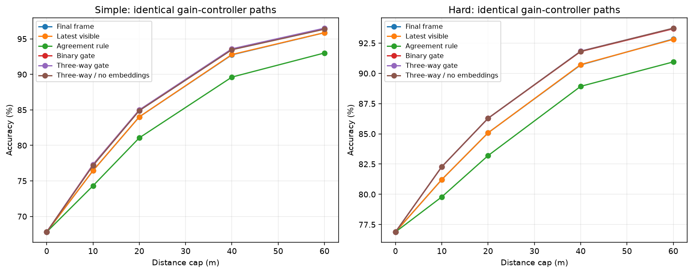
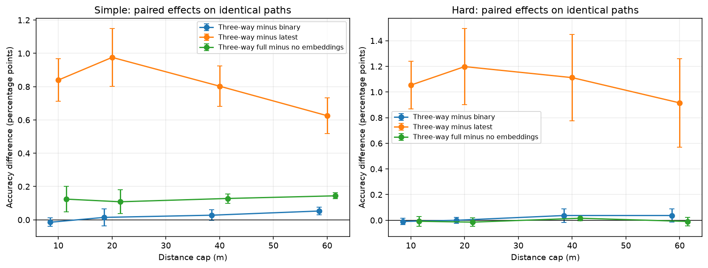
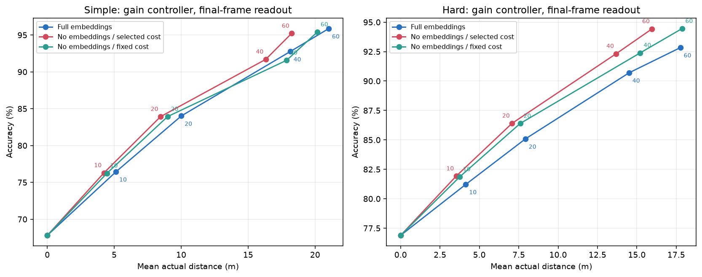

# 门控与额外视觉特征消融

沿用 90 DEVELOPMENT / 10 VALIDATION，最终在 100 TRAIN 场景重训；种子 42–46。五种子均逐权重复现原有完整模型，然后共享样本、初始化和批次顺序训练消融版本。

无 embedding 版本同时删除 raw/SAM 的 128 维特征，保留分类概率、目标框和位置；不能称为完全无视觉。二路门控只学习保留/替换，三路增加半半融合。两者使用相同的混合历史训练分布。

验证集选择成本：完整控制器 0.0005 /m；无 embedding 控制器 0.002 /m。另保留无 embedding、固定完整控制器成本 0.0005 /m 的对照。

所有原有测试集均已经探索过。本报告不将其描述为未触碰确认集。共同预算上限不等于共同实际移动距离。

## 结果图

## 主比较：完整收益控制器的相同轨迹

表中是五种子平均准确率（%）；同一行内各读出完全共享路径和距离。

| 划分 | cap m | 实耗 m | 最终帧 | 最高置信 | 均值 | 最新可见规则 | 一致性规则 | 二路 | 三路 | 二路无特征 | 三路无特征 |
|---|---:|---:|---:|---:|---:|---:|---:|---:|---:|---:|---:|
| simple | 0 | 0.00 | 67.81 | 67.81 | 67.81 | 67.81 | 67.81 | 67.81 | 67.81 | 67.81 | 67.81 |
| simple | 10 | 5.13 | 76.44 | 74.31 | 74.12 | 76.45 | 74.31 | 77.30 | 77.29 | 77.26 | 77.16 |
| simple | 20 | 10.01 | 84.02 | 81.06 | 80.86 | 84.02 | 81.06 | 84.98 | 85.00 | 84.87 | 84.89 |
| simple | 40 | 18.14 | 92.76 | 89.59 | 89.40 | 92.80 | 89.62 | 93.57 | 93.60 | 93.44 | 93.47 |
| simple | 60 | 21.02 | 95.87 | 92.84 | 91.75 | 95.88 | 93.02 | 96.45 | 96.50 | 96.28 | 96.36 |
| hard | 0 | 0.00 | 76.89 | 76.89 | 76.89 | 76.89 | 76.89 | 76.89 | 76.89 | 76.89 | 76.89 |
| hard | 10 | 4.14 | 81.22 | 79.79 | 79.68 | 81.22 | 79.79 | 82.28 | 82.27 | 82.31 | 82.28 |
| hard | 20 | 7.92 | 85.08 | 83.21 | 83.02 | 85.08 | 83.20 | 86.28 | 86.28 | 86.26 | 86.29 |
| hard | 40 | 14.51 | 90.70 | 88.92 | 88.69 | 90.73 | 88.93 | 91.80 | 91.84 | 91.75 | 91.82 |
| hard | 60 | 17.77 | 92.84 | 90.79 | 89.76 | 92.81 | 90.95 | 93.69 | 93.72 | 93.63 | 93.73 |

最新可见规则：新观察可见且未重复则替换。一致性规则：新旧 top-1 一致则融合，否则取最大概率更高的一方，平局取新。所有规则和门控共用不可见/重复保留与首次可见替换。

## 预先指定的同轨迹配对差值

单位为准确率百分点；括号为五种子配对 95% t 区间。区间条件于固定场景和上游模型，未做多重比较校正。

| 划分 | cap m | 二路−最新规则 | 二路−一致规则 | 三路−二路 | 三路−最新规则 | 三路−一致规则 | 二路完整−无特征 | 三路完整−无特征 |
|---|---:|---|---|---|---|---|---|---|
| simple | 10 | +0.854 [+0.717, +0.992] | +2.987 [+2.820, +3.154] | -0.015 [-0.040, +0.011] | +0.840 [+0.711, +0.968] | +2.973 [+2.828, +3.117] | +0.036 [+0.012, +0.059] | +0.124 [+0.047, +0.202] |
| simple | 20 | +0.961 [+0.770, +1.153] | +3.919 [+3.798, +4.040] | +0.015 [-0.036, +0.065] | +0.976 [+0.802, +1.150] | +3.934 [+3.803, +4.065] | +0.111 [+0.075, +0.148] | +0.108 [+0.037, +0.180] |
| simple | 40 | +0.775 [+0.652, +0.898] | +3.951 [+3.896, +4.007] | +0.028 [-0.004, +0.060] | +0.803 [+0.682, +0.924] | +3.979 [+3.908, +4.050] | +0.131 [+0.069, +0.193] | +0.128 [+0.100, +0.156] |
| simple | 60 | +0.573 [+0.465, +0.680] | +3.435 [+3.327, +3.544] | +0.053 [+0.029, +0.077] | +0.625 [+0.519, +0.732] | +3.488 [+3.363, +3.614] | +0.169 [+0.088, +0.250] | +0.144 [+0.126, +0.162] |
| hard | 10 | +1.063 [+0.870, +1.256] | +2.497 [+2.398, +2.595] | -0.009 [-0.034, +0.015] | +1.054 [+0.867, +1.241] | +2.487 [+2.402, +2.572] | -0.024 [-0.053, +0.006] | -0.008 [-0.046, +0.030] |
| hard | 20 | +1.198 [+0.904, +1.492] | +3.078 [+2.881, +3.275] | +0.000 [-0.023, +0.023] | +1.198 [+0.900, +1.496] | +3.078 [+2.876, +3.281] | +0.022 [+0.008, +0.037] | -0.015 [-0.049, +0.020] |
| hard | 40 | +1.075 [+0.724, +1.426] | +2.876 [+2.638, +3.114] | +0.037 [-0.016, +0.090] | +1.112 [+0.777, +1.448] | +2.913 [+2.666, +3.160] | +0.049 [+0.012, +0.085] | +0.016 [-0.004, +0.036] |
| hard | 60 | +0.878 [+0.526, +1.230] | +2.741 [+2.573, +2.909] | +0.037 [-0.015, +0.089] | +0.915 [+0.571, +1.259] | +2.778 [+2.636, +2.921] | +0.058 [+0.020, +0.096] | -0.009 [-0.042, +0.024] |

## 控制器的额外特征：最终帧读出

这组路径可以不同；显示准确率与实耗，不把准确率差值归因为同路径融合。图中点旁数字为距离上限（m）。

| 划分 | cap m | 完整：准确率 / m | 无特征、验证选成本：准确率 / m | 无特征、固定成本：准确率 / m |
|---|---:|---|---|---|
| simple | 10 | 76.44% / 5.13 | 76.29% / 4.23 | 76.24% / 4.46 |
| simple | 20 | 84.02% / 10.01 | 83.92% / 8.46 | 83.93% / 8.98 |
| simple | 40 | 92.76% / 18.14 | 91.70% / 16.32 | 91.57% / 17.88 |
| simple | 60 | 95.87% / 21.02 | 95.21% / 18.25 | 95.40% / 20.17 |
| hard | 10 | 81.22% / 4.14 | 81.92% / 3.53 | 81.86% / 3.75 |
| hard | 20 | 85.08% / 7.92 | 86.41% / 7.08 | 86.39% / 7.59 |
| hard | 40 | 90.70% / 14.51 | 92.32% / 13.69 | 92.39% / 15.22 |
| hard | 60 | 92.84% / 17.77 | 94.43% / 15.96 | 94.45% / 17.87 |

## 40 m hard：门控救回与误伤

| 读出 | 准确率 % | 救回占全部样本 % | 误伤占全部样本 % |
|---|---:|---:|---:|
| rule_latest | 90.73 | 0.05 | 0.02 |
| rule_agree | 88.93 | 0.72 | 2.49 |
| gate2_full | 91.80 | 1.43 | 0.33 |
| gate3_full | 91.84 | 1.43 | 0.28 |
| gate2_noembed | 91.75 | 1.48 | 0.42 |
| gate3_noembed | 91.82 | 1.47 | 0.35 |

## 核验与范围

独立核验通过，覆盖 200 份轨迹文件、3,025,000 条轨迹。另从检查点重放全部门控，以及新增控制器的动作决策。历史控制器路径通过原始文件哈希及路径一致性校验复用。

机器可读 metrics.json 保留所有控制器/读出/预算的五种子统计、配对差值、逐场景效应，包括历史 joint 路径上的辅助验证与无特征控制器路径上的迁移检查。完整动作数组和模型权重保留在本地 output/active_evidence_ablations。

本消融不区分 raw 与 SAM 特征各自的贡献，不评估移除上游图像分类器，不重训无特征 joint 控制器，也没有增加全新场景。一步前瞻、真实框假设和固定上游模型等限制仍然存在。
